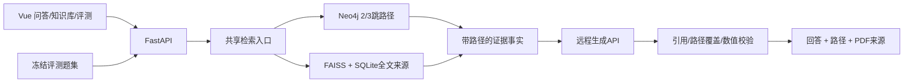

# 完整系统实现与验收对应

本阶段目标是先完成使用远程API的可运行校园问答系统。原任务书的本地模型限制按用户最新指令调整；历史报告和日志仅证明其注明的版本与运行条件。

## 架构

SQLite保存文档、来源块、关系证据、发布指针、问答日志、反馈和评测。Neo4j保存带批次ID的实体和关系。FAISS索引绑定源数据、模型、端点与维度。旧批次保留以便当次引用读回。

## 与题目要求对应

| 任务要求 | 实现 | 验收方法 |
|---|---|---|
| 文档导入、清洗、结构化抽取 | PDF/DOCX/TXT解析；条款/表格分块；规则候选；API辅助抽取；审核闸门 | 查看data原文哈希、审核链；运行prepare脚本到新目录 |
| 实体/关系/来源记录 | Professional、ProgramPlan、CourseCategory、RuleClause等白名单；每条关系关联来源Chunk | build/validate检查类型、跨批次隔离和证据 |
| 2/3跳推理 | 关系模式扩展、专业/年级过滤、版本冲突和未核验剪枝、完整路径排名 | 10题逐题查看hop_count、路径和hop_log |
| 可解释回答 | API只输出断言；引用全边覆盖与数值检查；PDF读回 | 点击引用核对页码；断链题拒答；关闭API验证降级 |
| 单机部署 | Compose 3常驻容器+初始化任务；Windows本机备用入口 | start.ps1或start-local.ps1，health/ready |
| ≥10题评测、≥3指标 | 5道2跳、5道3跳、3道负例；完整报告与持久化 | 评测中心导出报告并人工复核 |

## 图谱与证据边界

线上已核验图谱仅覆盖CS2024普通本科方案的5类课程要求。典型2跳是“培养方案 → 课程类别 → 条款”，3跳增加“专业 → 培养方案”。其余原文通过文档检索提供直接证据，不计算为多跳图谱成功。

现有审核由AI依据原文完成，保存审核者、时间与决策哈希，没有冒充人工审核。未核验OCR、目录和 rejected 关系不参与可用结论。API抽取结果始终 unverified，必须审核才可进入图谱。

断言校验主要控制引用存在、全路径边覆盖、数值是否来自证据；无法完整证明模型对条件、否定和制度适用范围的解释正确。评测的自动要点命中率也需人工复核。

## 配置和运行

API凭据只在后端。健康检查仅检查模型配置，避免每次探测产生费用；真实连通性由问答验证。模型异常、无效JSON或引用校验失败会显式摘录降级，报告单独统计API生成占比。

浏览器无登录账户系统；公开资料可读，反馈关联已有request_id，评测需DEMO_MODE或ADMIN_TOKEN。本机演示默认回环绑定。离线导入是当前数据管理入口，网页不提供上传按钮。

## 交付与人工完成项

代码、锁文件、向量与审核数据可进Git；API密钥、原PDF、运行数据库与索引不进Git。迁移要单独提供原PDF并匹配哈希。2026-11-10已完成848条新工作空间向量重建和13题真实API评测，报告见 `docs/logs/API_EVALUATION_20261110.md`。自动开发验证之后仍需组织人工盲测。

答辩材料应如实填写小组成员分工、数据来源授权、机器资源、真实API运行指标与失败案例，不根据自动开发过程编造成员贡献。后续扩展优先增加其他专业/年级的核验关系及独立盲测题。
